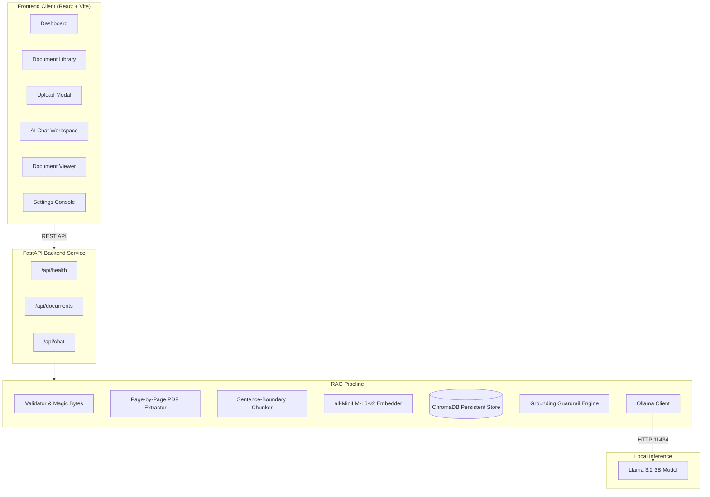

# DocNest — Enterprise Document Intelligence & RAG Platform

> **Your documents. Your questions. Clear answers.**

DocNest is a production-ready, AI-powered PDF question-answering platform built with **Retrieval-Augmented Generation (RAG)**, **ChromaDB**, **Sentence Transformers**, and locally running **Llama 3.2** via Ollama. It enables users to upload PDF documents, ask natural language questions, and receive accurate answers strictly grounded in document content with verified source page citations.

---

## 1. System Architecture



---

## 2. Key Features

- **Decoupled Architecture:** Clean separation of concerns with a FastAPI REST backend and a React/Vite single-page frontend.
- **Strict Grounding Guardrails:** Prompt engineering prevents hallucinations. If facts cannot be verified in the retrieved passages, the model explicitly states it cannot find the information.
- **Page-Aware Attributions:** Every chunk preserves its exact original PDF page number. Citations link directly to the page in the document viewer.
- **Deduplication:** Automatic SHA-256 content hashing detects duplicate uploads to avoid redundant vector generation.
- **Document Isolation:** Users can query across all uploaded documents or isolate questions to a single selected PDF.
- **Persistent Storage:** All embeddings and metadata are stored in local ChromaDB and file registries across server reboots.
- **Mandatory Industrial Palette:** High-contrast Forged Carbon (60%), Titanium Silver (30%), and Signal Yellow (10%) design language.

---

## 3. Mandatory Colour System

| Token | Hex Value | Role | Usage Ratio |
| :--- | :--- | :--- | :--- |
| **Forged Carbon Primary** | `#202326` | Main App Background | 60% Surfaces |
| **Forged Carbon Secondary** | `#292D30` | Cards & Containers | |
| **Forged Carbon Deep** | `#171A1C` | Sidebars & Modals | |
| **Titanium Silver Light** | `#E0E3E5` | Primary Headings | 30% Content |
| **Titanium Silver Primary** | `#BFC3C7` | Body Text & Data | |
| **Titanium Silver Secondary**| `#969DA3` | Metadata & Secondary | |
| **Titanium Border** | `#555C61` | Dividers & Borders | |
| **Signal Yellow** | `#F4D21F` | Action Buttons & Active States | 10% Accents |
| **Signal Yellow Hover** | `#FFDF45` | Button Hover | |

---

## 4. Repository Structure

```
.
├── backend/
│   ├── app/
│   │   ├── api/             # REST Routers: health, documents, chat
│   │   ├── core/            # Configuration and Pydantic settings
│   │   ├── models/          # Schemas and document models
│   │   ├── services/        # Extractor, chunker, embedder, chroma, ollama, rag
│   │   └── main.py          # FastAPI application entrypoint
│   ├── documents/           # Stored PDF binaries and registry.json
│   ├── chroma_db/           # ChromaDB persistent vector database
│   └── requirements.txt     # Python backend dependencies
├── frontend/
│   ├── src/
│   │   ├── components/      # UploadModal, DocumentViewer, CitationCard, ErrorBoundary
│   │   ├── layouts/         # AppLayout
│   │   ├── pages/           # Dashboard, DocumentLibrary, ChatWorkspace, Settings
│   │   ├── services/        # api.js client
│   │   ├── styles/          # Tailwind & custom carbon tokens
│   │   ├── App.jsx
│   │   └── main.jsx
│   ├── package.json
│   └── vite.config.js
├── tests/                   # Automated pytest suite
├── docs/                    # Architecture and baseline audit documentation
├── .env.example             # Configuration template
├── docker-compose.yml       # Production container orchestration
├── Dockerfile.backend
└── README.md
```

---

## 5. Getting Started

### Prerequisites
- Python 3.11+
- Node.js 18+ and npm
- [Ollama](https://ollama.com/) running locally:
  ```bash
  ollama pull llama3.2
  ```

### 1. Backend Setup
```bash
# Clone the repository
git clone https://github.com/reddy895/DocNest.git
cd DocNest

# Create and activate virtual environment
python3 -m venv .venv
source .venv/bin/activate

# Install dependencies
pip install -r backend/requirements.txt

# Start FastAPI backend
uvicorn backend.app.main:app --host 0.0.0.0 --port 8000 --reload
```
The API documentation is accessible at `http://localhost:8000/docs`.

### 2. Frontend Setup
```bash
# In a separate terminal:
cd frontend

# Install node dependencies
npm install

# Start Vite development server
npm run dev
```
The web application is accessible at `http://localhost:5173`.

---

## 6. Docker Deployment

To launch the full stack with Docker Compose:
```bash
docker compose up --build
```
- Frontend: `http://localhost:5173`
- Backend API: `http://localhost:8000`

---

## 7. Running Tests

### Backend Test Suite
```bash
PYTHONPATH=. .venv/bin/pytest tests/ -v
```

### Frontend Production Build Check
```bash
cd frontend
npm run build
```

---

## 8. REST API Reference

| Method | Endpoint | Description |
| :--- | :--- | :--- |
| `GET` | `/` | API status and root metadata |
| `GET` | `/api/health` | Comprehensive system & Ollama health check |
| `GET` | `/api/documents` | List all indexed documents with summary statistics |
| `POST`| `/api/documents/upload` | Upload, validate, extract, and index a PDF file |
| `GET` | `/api/documents/{doc_id}` | Retrieve document metadata by ID |
| `GET` | `/api/documents/{doc_id}/file` | Download or stream raw PDF file for viewing |
| `DELETE` | `/api/documents/{doc_id}` | Delete document and purge vector chunks from ChromaDB |
| `POST`| `/api/chat/query` | Submit natural language query with strict RAG grounding |
| `GET` | `/api/chat/suggestions` | Fetch dynamic, contextual question suggestions |

---

## 9. License

MIT License. Designed and engineered for institutional document intelligence.

