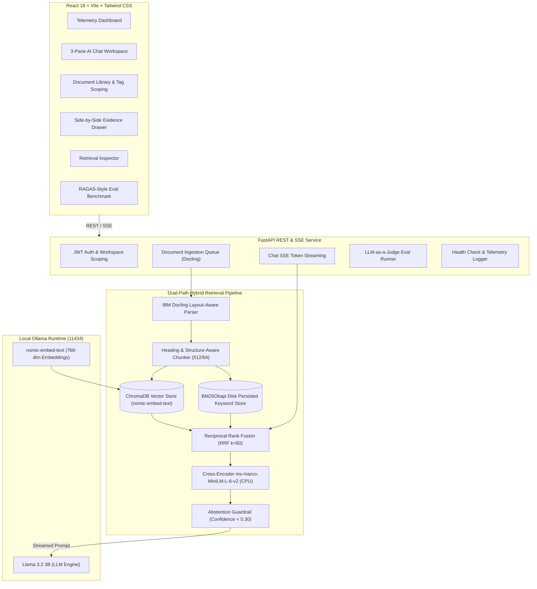

# DocNest — Production-Grade Local RAG Intelligence Platform

> **Your documents. Your questions. Clear answers.**

DocNest is an enterprise-grade, local document intelligence platform powered by **Retrieval-Augmented Generation (RAG)**, **Ollama (Llama 3.2 3B)**, **ChromaDB**, **BM25 Sparse Search**, and **Cross-Encoder Reranking**. It delivers layout-aware PDF parsing, multi-turn conversational query rewriting, strict inline page citations, and automatic abstention guardrails—optimized for systems with **12 GB RAM**.

---

## 1. System Architecture



---

## 2. Core Upgrades & Engineering Highlights

### A. Layout-Aware Ingestion & Background Queue
- **IBM Docling Parser:** Layout-aware conversion of PDFs into structured Markdown with automatic fallback, preserving reading order and multi-column tables.
- **Structure-Aware Chunking:** Recursively splits on headings (`#`, `##`, `###`) into 512-character blocks with 64-character overlap, attaching rich metadata (`doc_id`, `filename`, `page_number`, `section_heading`, `workspace_id`).
- **Async Ingestion Worker:** Non-blocking background worker with granular stage tracking (`queued -> parsing -> chunking -> embedding -> ready | failed`).
- **1-Click Sample Datasets:** Bundles 3 curated PDFs (*Quarterly Financial Report*, *Enterprise AI Architecture Whitepaper*, *Corporate Compliance Policy Manual*) for instant onboarding.

### B. Dual-Path Hybrid Search & Cross-Encoder Reranking
- **Dense Vector Search:** High-speed 768-dimensional embeddings generated locally by Ollama `nomic-embed-text` with LRU caching.
- **BM25 Sparse Keyword Search:** Persistent inverted index synchronized with ChromaDB collections for exact keyword precision.
- **Reciprocal Rank Fusion (RRF):** Fuses dense and sparse candidate rankings:
  $$\text{RRF}(d) = \sum_{m \in \{\text{dense}, \text{sparse}\}} \frac{1}{60 + \text{rank}_m(d)}$$
- **Cross-Encoder Reranking:** Re-scores top-20 candidates using `cross-encoder/ms-marco-MiniLM-L-6-v2` with sigmoid normalization and batched CPU inference optimized for 12GB RAM.
- **Abstention Guardrail:** Short-circuits generation and returns an explicit abstention response if the maximum reranker confidence score falls below `0.30`.

### C. Conversational Query Rewriting & Strict Citations
- **Conversational Query Rewriting:** Fast pre-step with Llama 3.2 rewriting multi-turn follow-ups (e.g., *"What are its risks?"*) into self-contained standalone retrieval queries.
- **Strict Inline Citations:** Factual claims cited inline in `[Filename, p. X]` format.
- **SSE Token Streaming:** `POST /api/chat/stream` yields tokens, status milestones, and latency traces in real-time.

### D. RAG Evaluation Suite (LLM-as-a-Judge)
- Scores test datasets on **Faithfulness** (supported claims), **Answer Relevancy**, and **Context Precision@K**.
- Tracks **P50 / P95 latencies** across retrieval, reranking, and generation.
- Historical evaluation runs persisted in SQLite for continuous benchmark visibility.

---

## 3. Mandatory Color System (Forged Carbon Aesthetic)

| Token Role | Hex Code | Purpose |
| :--- | :--- | :--- |
| **Primary Background** | `#202326` | Main application backdrop |
| **Secondary Background**| `#292D30` | Cards, panels, active message containers |
| **Dark Surfaces** | `#303538` | Interactive user turns and elevated controls |
| **Deep Carbon** | `#171A1C` | Sidebars, navigation bars, and inputs |
| **Titanium Silver** | `#BFC3C7` / `#E0E3E5` | Text hierarchy and metadata labels |
| **Borders** | `#555C61` | Subtle industrial boundaries |
| **Signal Yellow** | `#F4D21F` | Primary actions, active indicators, confidence accents |

---

## 4. Quick Start Guide

### Prerequisites
1. **Ollama:** Installed and running locally:
   ```bash
   ollama pull llama3.2
   ollama pull nomic-embed-text
   ollama serve
   ```
2. **Python 3.11+** & **Node.js 18+**

### Single-Command Startup
Install root dependencies and launch both backend and frontend concurrently:
```bash
npm install
npm run dev
```
- **Frontend UI:** `http://localhost:5173`
- **FastAPI Documentation:** `http://localhost:8000/docs`
- **System Health:** `http://localhost:8000/api/system/health`

---

## 5. REST & SSE API Reference

| Method | Endpoint | Description |
| :--- | :--- | :--- |
| `POST` | `/api/auth/register` | Register new user and workspace |
| `POST` | `/api/auth/login` | Obtain JWT bearer token |
| `GET` | `/api/documents` | List indexed documents and global statistics |
| `POST` | `/api/documents/upload` | Upload and vectorize PDF with background queue |
| `GET` | `/api/documents/{id}/status` | Real-time ingestion stage and progress polling |
| `POST` | `/api/documents/load-sample` | 1-click curated sample dataset loader |
| `POST` | `/api/chat/stream` | Server-Sent Events (SSE) token and citation stream |
| `POST` | `/api/chat/sessions` | Create persistent conversation session |
| `POST` | `/api/chat/{id}/feedback` | Record user thumbs-up/down message rating |
| `POST` | `/api/eval/run` | Trigger automated LLM-as-a-judge quality benchmark |
| `GET` | `/api/system/dashboard-stats`| Consolidated telemetry summary for top strip |
| `GET` | `/api/system/health` | Live health check with component latency breakdown |

---

## 6. Ollama Supervisor & Minimal UI

- **Ollama Supervisor:** Automatically detects whether Ollama daemon is running at `http://localhost:11434` when the backend launches. If offline, the backend lifespan supervisor automatically spawns `ollama serve` and polls until connected.
- **Minimal Obsidian Palette:** Clean, distraction-free matte carbon surfaces (`#0C0D0E`, `#121417`), subtle hairline borders (`#20242A`), crisp titanium silver text (`#F0F2F5`), and warm yellow accents (`#F5C542`).
- **Interactive Centered Hero:** Prominent centered "DocNest" brand hero with starter prompts that gracefully disappears as soon as you enter a message or begin research.

---

## 7. Verification & Automated Testing

Run backend test suites:
```bash
.venv/bin/pytest tests/
```
Verify frontend production build:
```bash
cd frontend && npm run build
```

---

## 8. License
DocNest is dual-licensed under either:
- [MIT License](LICENSE-MIT)
- [Apache License, Version 2.0](LICENSE-APACHE)

You may choose either license at your option.
