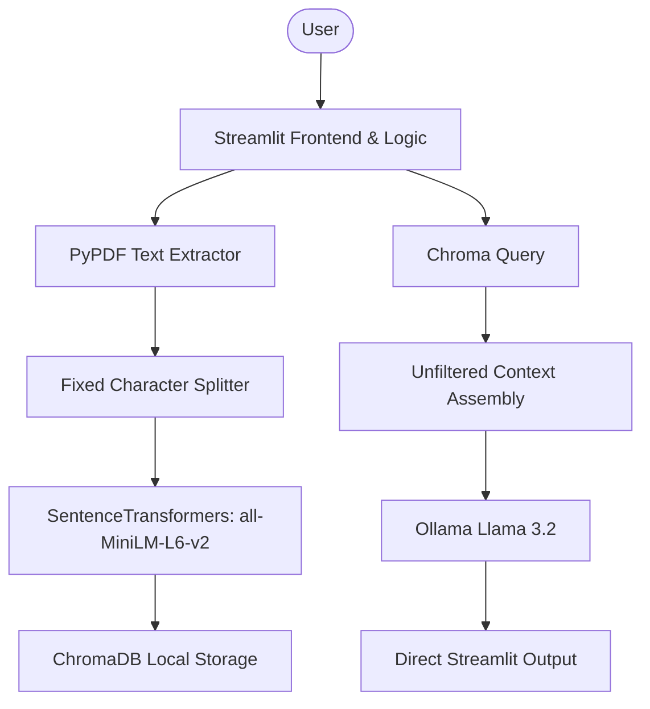

# DocNest Architecture Overview & Transformation Design

## 1. Monolithic Baseline Architecture (Legacy)

### Limitations of Baseline:
- Synchronous UI-blocking operations during PDF parsing and embedding.
- No separation of presentation layer from data persistence.
- Missing REST API interface for third-party integrations or modern web clients.
- Inability to scale frontend and backend independently.

---

## 2. Target Decoupled Architecture (DocNest Platform)

```mermaid
flowchart LR
    subgraph Client["Frontend: React + Vite + Tailwind CSS"]
        UI_Dash[Dashboard]
        UI_Lib[Document Library]
        UI_Up[Upload Zone]
        UI_Chat[AI Chat Workspace]
        UI_View[PDF Viewer]
        UI_Set[Settings & Status]
    end

    subgraph Server["Backend: FastAPI Service"]
        API_Route[API Routers: Documents, Chat, Health]
        Service_Val[PDF & Magic Byte Validator]
        Service_Ext[Page-Aware Text Extractor]
        Service_Chunk[Sentence-Boundary Chunker]
        Service_Embed[SentenceTransformer Embedding Pool]
        Service_Chroma[ChromaDB Persistent Store]
        Service_RAG[Grounded Prompt & Citation Engine]
        Service_Ollama[Ollama LLM Connector]
    end

    subgraph Storage["Storage Layer"]
        PDF_Store[(Original Documents /docs)]
        Chroma_Store[(Vector Store /chroma_db)]
        Local_LLM[(Local Llama 3.2)]
    end

    Client -->|REST API HTTP/JSON| API_Route
    API_Route --> Service_Val
    Service_Val --> Service_Ext
    Service_Ext --> Service_Chunk
    Service_Chunk --> Service_Embed
    Service_Embed --> Service_Chroma
    Service_Chroma --> Chroma_Store
    Service_Val --> PDF_Store
    
    API_Route --> Service_RAG
    Service_RAG --> Service_Chroma
    Service_RAG --> Service_Ollama
    Service_Ollama --> Local_LLM
```

---

## 3. Dependency Inventory & Upgrades

| Component | Target Version / Tech | Role |
| :--- | :--- | :--- |
| **API Framework** | FastAPI `^0.115` | High-performance asynchronous REST API |
| **Server** | Uvicorn `^0.34` | ASGI server with workers and reload capability |
| **Validation** | Pydantic v2 `^2.10` | Strict schema serialization and data validation |
| **Vector DB** | ChromaDB `^0.5` | Persistent vector store with metadata filtering |
| **Embeddings** | `all-MiniLM-L6-v2` | Fast 384-dimensional sentence embeddings |
| **LLM Runtime** | Ollama (`llama3.2`) | Local inference with high precision and low latency |
| **Frontend** | React 18 + Vite | Modern reactive client architecture |
| **Styling** | Tailwind CSS v3 | Design system tokens for Forged Carbon palette |
| **Icons** | Lucide React | Clean, lightweight industrial icons |

